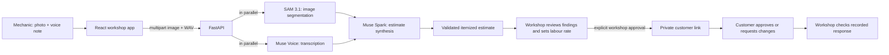

# PanelScan

PanelScan helps vehicle workshops turn a damage photo and a mechanic's voice
note into an itemized repair estimate. A workshop reviews and approves the
estimate before sharing it with a customer, who can approve it or request
changes.

> **Prototype notice:** Model findings and parts prices can be wrong. Parts
> prices are not verified against supplier catalogues. Every estimate is
> provisional until a qualified workshop reviews and approves it. Customer
> approval in PanelScan is not an electronic signature or authorization to
> begin repairs.

## How it works



SAM 3.1, Muse Voice Transcribe, and Muse Spark are called server-side through
Meta Model API. The browser converts recorded or uploaded audio to mono 24 kHz
PCM WAV before sending it to the backend.

## Features

- Capture or upload one vehicle-damage photo and one mechanic voice note.
- Transcribe the note, segment the image, and combine the results into a
  schema-validated estimate.
- Review each suggested finding alongside the original photo and playable
  recording.
- Enter the workshop's hourly labour rate and see the calculated labour
  estimate and total.
- Require explicit workshop approval before creating a customer link.
- Let a customer review proposed work and costs, then approve or request
  changes; let the workshop check the recorded response.
- Run a deterministic demo mode without calling Meta.

The estimate includes a vehicle summary, damage items, a parts estimate in ZAR,
and estimated labour hours. The current parts estimate has no supplier
catalogue integration and must not be presented as a verified quote.

## Technology

- **Frontend:** React 19, TypeScript 7, Vite 8, Tailwind CSS 3, Oxlint
- **Backend:** Python 3.10+, FastAPI, Pydantic, Uvicorn, SQLite
- **Model APIs:** Meta Model API — SAM 3.1, Muse Voice Transcribe, Muse Spark
- **Tests:** pytest and Ruff for the backend; TypeScript build and Oxlint for
  the frontend

## Getting started

### Prerequisites

- Python 3.10 or later
- Node.js 20.19+ or 22.12+, and npm
- A Meta Model API key for live model calls

### Configure the backend

From the repository root, create a virtual environment and install the backend
dependencies:

```bash
cd backend
python3 -m venv .venv
source .venv/bin/activate
pip install -r requirements.txt
cd ..
```

Copy the example configuration to the repository root and add your API key:

```bash
cp .env.example .env
```

Set `MODEL_API_KEY` in `.env`. Keep this file private; `.env` is ignored by
Git. Do not put API keys in frontend environment variables or commit them.

### Start the app

In one terminal, start the API from the `backend/` directory:

```bash
cd backend
source .venv/bin/activate
uvicorn app.main:app --reload --port 8000
```

In another terminal, install and start the frontend:

```bash
cd frontend
npm ci
npm run dev
```

Open the local URL printed by Vite. Allow microphone access if recording a
voice note. You can also upload a photo and audio recording.

The frontend defaults to `http://localhost:8000` for the API. To use another
API URL, create `frontend/.env.local` and set:

```dotenv
VITE_API_URL=http://localhost:8000
```

If the frontend and backend use different origins, add the frontend origin to
`PANELSCAN_CORS_ORIGINS` in the root `.env` (comma-separated for multiple
origins).

### Demo mode

To run without a Meta API key, set this in the root `.env`:

```dotenv
PANELSCAN_DEMO_MODE=true
```

Demo mode returns deterministic sample transcription, segmentation, and
estimate data instead of calling Meta. It is intended for local demos and
testing only. Set it back to `false` for live model calls. If credentials are
missing in live mode, the API reports an error instead of silently substituting
demo output.

## Customer approval workflow

1. The mechanic generates an estimate and checks every suggested finding.
2. The mechanic enters the workshop's hourly labour rate and explicitly
   approves the estimate.
3. PanelScan creates a private link for the customer.
4. The customer reviews the proposed work and estimated costs, then approves
   or requests changes.
5. The workshop returns to the assessment and checks the customer's response.

The customer response is a recorded preference, not a signature, payment, or
repair authorization. Confirm the final work authorization directly with the
customer before repairs begin.

Approval links expire after 30 days and accept one response. The backend stores
the estimate, labour rate, response, and a hash of the private link token; it
does not store the uploaded photo or recording with the approval. By default,
the SQLite database is `backend/data/approvals.sqlite3`, which is ignored by
Git. Set `PANELSCAN_APPROVALS_DB` to a persistent database path if records need
to survive environment rebuilds or deployments. Anyone with an active private
link can view its estimate and submit its one response; share links only with
their intended customer.

## API

| Method | Path | Purpose |
|---|---|---|
| `GET` | `/health` | Check API availability |
| `POST` | `/api/assess-damage` | Upload `image` and `audio`; return a validated `QuoteEstimate` |
| `POST` | `/api/approvals` | Create an approval record from a reviewed estimate and labour rate |
| `GET` | `/api/approvals/{token}` | Read the customer-facing estimate and current status |
| `POST` | `/api/approvals/{token}/decision` | Record `approved` or `changes_requested` |

Interactive API documentation is available at `http://localhost:8000/docs` when
the backend is running.

`QuoteEstimate` contains `vehicle_summary`, `damage_items`,
`total_parts_estimate_zar`, and `total_labor_hours`. Each damage item contains
`panel_name`, `damage_type`, `recommended_action` (`repair` or `replace`), and
`ai_confidence_score`. The confidence value is a model-provided indicator, not
proof that a finding is correct.

## Development and tests

Run backend tests and lint from the `backend/` directory:

```bash
source .venv/bin/activate
pytest -q
ruff check --target-version py310 app tests
```

Run the frontend production build and lint from the `frontend/` directory:

```bash
npm run build
npm run lint
```

Before sharing changes, run the relevant checks and `git diff --check`. Never
commit `.env`, API keys, customer information, or uploaded vehicle media.

## Contributing

Create a focused branch from `main`, make the smallest change that addresses
the issue, and add or update tests for behavior changes. Keep API contracts in
the backend Pydantic schemas and update the frontend types when those contracts
change. Keep model API calls in `backend/app/services/` rather than the
browser.

Before opening a pull request, run the backend tests and lint plus the frontend
build and lint above. Describe user-visible behavior and any configuration or
API changes in the pull request. Do not include secrets, customer data, local
approval databases, or uploaded media.

## Project structure

```text
.
├── backend/
│   ├── app/
│   │   ├── approvals.py          # Private-token customer approval records
│   │   ├── main.py               # FastAPI routes and assessment orchestration
│   │   ├── schemas.py            # Estimate request/response data contracts
│   │   └── services/
│   │       ├── meta_client.py    # SAM 3.1 and Muse Voice API adapters
│   │       └── muse_client.py    # Muse Spark estimate generation
│   ├── data/                     # Local approval database (Git-ignored)
│   └── tests/                    # API and model-client tests
├── frontend/
│   ├── public/fonts/             # Self-hosted UI fonts and licenses
│   └── src/
│       ├── App.tsx               # Workshop and customer approval flows
│       └── index.css             # Responsive interface styles
├── .env.example                  # Backend configuration template
├── PRODUCT.md                    # Product behavior and design constraints
├── SCOPE.md                      # Hackathon scope and model architecture
└── JOURNAL.md                    # Build notes and implementation history
```

## Project notes

- This repository was started as a standalone hackathon project. See
  [`SCOPE.md`](./SCOPE.md) for the stated scope and submission checklist.
- See [`PRODUCT.md`](./PRODUCT.md) for product constraints and interface
  principles, and [`JOURNAL.md`](./JOURNAL.md) for implementation history.
- There is currently no `LICENSE` file. No license for reuse is granted by
  this README.
